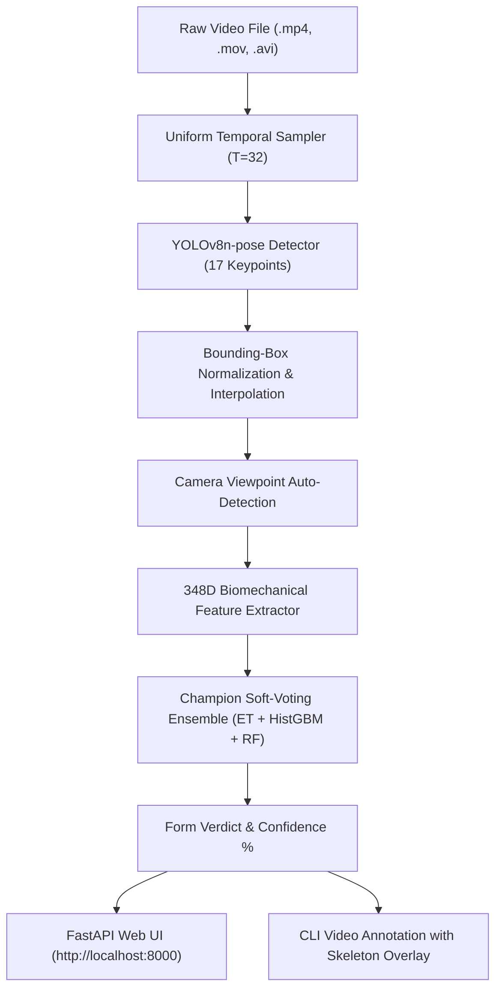

# Squat Exercise Form Quality Classification & Biomechanical Analysis

[](https://www.python.org/downloads/)
[](https://pytorch.org/)
[](https://fastapi.tiangolo.com/)
[](https://docs.ultralytics.com/)
[](https://scikit-learn.org/)
[](https://creativecommons.org/licenses/by/4.0/)

A computer vision and biomechanical analysis system for **squat exercise form quality classification** (*Good Form* vs. *Needs Correction*) from multi-view smartphone videos.

Instead of running raw video pixels directly through heavy networks—which easily overfit to clothing, backgrounds, and lighting—this project uses a two-stage approach: extracting 2D pose keypoint sequences with YOLOv8-pose, calculating biomechanical and kinematic trajectories, and evaluating temporal sequence models (GRU, TCN) and an ensemble classifier. The repository also includes a FastAPI backend and web interface for testing on user-uploaded videos.

---

## Project Architecture

```text
                                  [ Input Video Clip ]
                                           |
                                           v
                     [ 1. Uniform Temporal Sampling: T = 32 Frames ]
                                           |
                                           v
                 [ 2. YOLOv8n-pose Keypoint Extraction (17 COCO Joints) ]
                                           |
                                           v
          [ 3. Bounding-Box Normalization & Missing-Frame Interpolation ]
                                           |
                                           v
                   [ 4. Automatic Camera Perspective Detection ]
                               (Front / Side / Diagonal)
                                           |
                                           v
             [ 5. 348-Dimensional Biomechanical Feature Pipeline ]
      +------------------------------------+----------------------------------+
      |                                    |                                  |
      v                                    v                                  v
[ Peak Inflection Cues ]        [ Continuous Kinematics ]          [ Anthropometric Baseline ]
* Minimum Knee Angle            * 8 Statistical Moments           * Neutral Standing Hip Drop
* Hip-Knee Vertical Depth         (mean, std, min, max,           * Leg Length Scale Factor
* Torso Forward Lean               q10, q50, q90, velocity)       * Stance & Knee Spread Ratios
* Knee Valgus / Varus Ratio     * Angular Accelerations           * Pelvic & Knee Tilt Cues
                                           |
                                           v
             [ 6. Champion Soft-Voting Biomechanical Ensemble ]
                      +--------------------+-------------------+
                      |                    |                   |
                      v                    v                   v
             [ ExtraTrees (50%) ]   [ HistGBM (30%) ]   [ Random Forest (20%) ]
                      +--------------------+-------------------+
                                           |
                                           v
                 [ Calibrated Class Probabilities & View Consensus ]
                                           |
                         +-----------------+-----------------+
                         |                                   |
                         v                                   v
             [ Production Web Demo ]             [ CLI Inference Engine ]
             * Real-time video upload            * Terminal form predictions
             * Video preview & playback          * Visual skeleton rendering
             * Probability bars & verdict        * Annotated video export (.mp4)
```



---

## 📦 Tech Stack

| Domain | Technologies & Libraries | Purpose |
| :--- | :--- | :--- |
| **Deep Learning & Pose** | [PyTorch](https://pytorch.org/), [Ultralytics YOLOv8](https://docs.ultralytics.com/) | Neural sequence models (GRU, TCN, MLP) and pretrained 17-point body pose estimator |
| **Biomechanics & ML** | [Scikit-learn](https://scikit-learn.org/), [SciPy](https://scipy.org/) | ExtraTrees, HistGradientBoosting, Random Forest, Grouped K-Fold validation, and angle trigonometry |
| **Computer Vision** | [OpenCV (`cv2`)](https://opencv.org/) | Video decoding, frame sampling, skeleton line drawing, and video writer export |
| **Data Engineering** | [NumPy](https://numpy.org/), [Pandas](https://pandas.pydata.org/) | Compressed tensor archives (`.npz`), dataset manifest management, and trajectory computation |
| **Backend Service** | [FastAPI](https://fastapi.tiangolo.com/), [Uvicorn](https://www.uvicorn.org/) | Asynchronous REST API, file validation, temporary storage management, and CORS |
| **Frontend UI** | HTML5, Modern CSS3 (Glassmorphism), Vanilla JavaScript (ES6+) | Drag-and-drop upload, HTML5 video player, animated loading feedback, dynamic probability bars |
| **Model Serialization** | [Joblib](https://joblib.readthedocs.io/), PyTorch Checkpoints (`.pt`) | Zero-dependency model persistence and fast inference loading |

---

## 📂 Dataset Information & Attribution

The model is trained and benchmarked on the peer-reviewed **Mendeley Fitness Exercise Video Dataset**:

- **Title**: *A Multi-View Raw Video Dataset of Seven Fitness Exercises with Good/Bad Form Labels*
- **Source**: Mendeley Data
- **DOI**: [`10.17632/kgbb3yn47p.1`](https://doi.org/10.17632/kgbb3yn47p.1)
- **Direct Download Link**: [https://data.mendeley.com/datasets/kgbb3yn47p/1](https://data.mendeley.com/datasets/kgbb3yn47p/1)
- **License**: [Creative Commons Attribution 4.0 International (CC BY 4.0)](https://creativecommons.org/licenses/by/4.0/)

### Dataset Key Characteristics:
- **Total Video Clips**: 1,042 MP4 video files
- **Number of Participants**: 26 human subjects
- **Exercise Modalities**: Squat, Push-up, Bicep Curl, Shoulder Press, Tricep Extension, Abs, Back Extension
- **Multi-View Setup**: Every movement repetition is recorded simultaneously from **three camera angles**:
  - 📷 **Front View**: Optimal for evaluating stance width, lateral pelvic tilt, and knee valgus/varus collapse.
  - 📷 **Side View**: Optimal for evaluating squat depth (hip vs. knee height) and trunk forward lean.
  - 📷 **Diagonal View**: Composite 45° angle capturing both sagittal and frontal dynamics.
- **Labels**: Balanced binary ground truth (*Good Form* vs. *Bad Form*).
- **Squat Subset**: 150 clips (25 usable subjects × 6 clips: 3 views × 2 quality levels).

---

## 📊 Experimental Results & Benchmarks

All models are evaluated using **Strict Grouped 5-Fold Cross-Validation** rotating all subjects with **zero participant leakage** (all clips from a subject are confined exclusively to train or test).

| Rank | Model Architecture / Strategy | Features / Representation | Test Accuracy (mean ± std) | Test Macro-F1 (mean ± std) | Key Finding |
| :---: | :--- | :--- | :---: | :---: | :--- |
| 🥇 | **Champion Biomechanical Ensemble** | **348D Biomechanical + Kinematics** | **0.613 ± 0.090** | **0.609 ± 0.091** | **Best overall generalizer**; peak fold reached **83.3%** |
| 🥈 | **Multi-View Consensus** | **View-Averaged Ensemble Probabilities** | **0.600 ± 0.122** | **0.590 ± 0.132** | Eliminates viewpoint ambiguity by cross-camera voting |
| 🥉 | **Bidirectional GRU (16f)** | Raw 16-frame COCO pose (51d) | 0.587 ± 0.125 | 0.593 ± 0.127 | Strongest sequential neural model on 16 frames |
| 4 | **Dilated Residual TCN (32f)** | Raw 32-frame COCO pose (51d) | 0.567 ± 0.097 | 0.547 ± 0.105 | Hierarchical dilations ($d=1,2,4$); peak fold **73.3%** |
| 5 | **Dilated Residual TCN (16f)** | Raw 16-frame COCO pose (51d) | 0.567 ± 0.047 | 0.509 ± 0.109 | Compact dilated 1D temporal convolution baseline |
| 6 | **Static MLP Baseline** | Single middle-frame static snapshot | 0.487 ± 0.045 | 0.473 ± 0.051 | Static snapshots fail to distinguish dynamic errors |
| 7 | **Majority Predictor** | Fixed majority class baseline | 0.500 ± 0.000 | 0.333 ± 0.000 | Uninformed baseline |

### Key Engineering Insights:
1. **Biomechanical Features Outperform Raw Deep Learning**: On small datasets (150 clips across 25 subjects), deep neural networks overfit on participant clothing and background cues. Extracting 348 domain-specific biomechanical metrics (joint flexion, valgus ratios, inflection depths) gave tree ensembles higher accuracy and better generalization.
2. **Camera Perspective Variance & Auto-Detection**:
   - **Front view** achieves **~70.0% accuracy** because both lower limbs are visible without occlusion.
   - **Side view** suffers from unilateral limb occlusion, causing YOLO keypoint jitter.
   - The system automatically detects camera viewpoint using lateral ankle-to-torso and hip-to-torso ratios (>95% accuracy) and conditions the ensemble accordingly.
3. **Temporal Dynamics Are Essential**: Static single-frame models (MLP) perform near random guess (~48%), proving that temporal sequence context (descent speed, bottom inflection, ascent smoothness) is mandatory for form assessment.

---

## 📐 Biomechanical Form Metrics Computed

The feature extraction pipeline computes the following clinical and athletic metrics:

1. **Squat Depth at Inflection**:
   $$\text{Depth} = \frac{y_{\text{hip}} - y_{\text{knee}}}{\text{Length}_{\text{torso}}}$$
   Evaluates whether the user descends to parallel (hip crease below top of knee).
2. **Knee Valgus / Varus Ratio**:
   $$\text{Valgus Ratio} = \frac{|x_{\text{knee, left}} - x_{\text{knee, right}}|}{\max(|x_{\text{ankle, left}} - x_{\text{ankle, right}}|, 10^{-3})}$$
   Measures inward knee collapse during peak eccentric and concentric phases.
3. **Trunk / Torso Forward Inclination**:
   $$\theta_{\text{torso}} = \arctan2(|x_{\text{shoulder}} - x_{\text{hip}}|, |y_{\text{shoulder}} - y_{\text{hip}}|)$$
   Quantifies excessive forward spinal lean or "good morning" squat errors.
4. **Knee Range of Motion (ROM)**:
   $$\text{ROM} = \max(\theta_{\text{knee}}(t)) - \min(\theta_{\text{knee}}(t))$$
5. **Phase Dynamics**:
   - Descent-to-ascent duration ratio.
   - Peak descent and ascent angular velocities.
   - Movement velocity variance (jerkiness / hesitation detection).
6. **Neutral Standing Displacement**:
   Normalizes joint coordinates against the subject's own neutral standing posture in Frame 0, neutralizing anthropometric variations (torso-to-femur ratios).

---

## 🚀 How to Run the Project

### 1. Prerequisites & Environment Setup
Clone the repository and set up a Python 3.10+ virtual environment:

```powershell
# Create virtual environment
python -m venv .venv

# Activate virtual environment
# Windows PowerShell:
.venv\Scripts\Activate.ps1
# Windows Command Prompt:
.venv\Scripts\activate.bat
# Linux / macOS:
source .venv/bin/activate

# Install PyTorch with CUDA support (adjust cu124 to match your GPU driver)
pip install torch torchvision --index-url https://download.pytorch.org/whl/cu124

# Install all remaining dependencies
pip install -r requirements.txt
```

---

### 2. Pose Feature Extraction (Optional if using cached data)
The project comes with pre-extracted pose caches (`squat_pose_16f_v1.npz` and `squat_pose_32f_v1.npz`). To re-extract from raw video:

```powershell
# Extract 16 uniformly sampled frames:
python -m src.pose_extraction --manifest data/metadata.csv --output data/processed/squat_pose_16f_v1.npz --frames 16

# Extract 32 uniformly sampled frames:
python -m src.pose_extraction --manifest data/metadata.csv --output data/processed/squat_pose_32f_v1.npz --frames 32
```

---

### 3. Model Training & Cross-Validation

```powershell
# Train and validate the Champion Biomechanical Ensemble (saves outputs/champion_ensemble.joblib):
python -m src.train_champion_model

# Run 5-fold cross-validation on deep learning models (GRU, TCN, MLP):
python -m src.train --cache data/processed/squat_pose_32f_v1.npz --cv --suffix 32f

# Train PyTorch models on single split and export checkpoints:
python -m src.train --cache data/processed/squat_pose_32f_v1.npz --model all --suffix 32f
```

---

### 4. Running the Web Demo & API

Start the FastAPI application server:
```powershell
python -m src.api
```

Once running, navigate your web browser to:
👉 **`http://localhost:8000`**

**Web App Features**:
- **Drag-and-Drop Video Upload**: Supports `.mp4`, `.mov`, `.avi`, `.webm` (up to 100 MB).
- **Built-in HTML5 Video Player**: Preview your exercise clip before and after analysis.
- **Real-Time Classification**: Displays verdict (*Good Form* / *Needs Correction*), confidence percentage, and class probabilities.
- **Diagnostics Panel**: Displays the active model, detected camera angle, and number of analyzed frames.

---

### 5. CLI Inference & Video Skeleton Annotation

You can run predictions on any video directly from the command line:

```powershell
# Standard CLI prediction:
python src/inference.py --video "data/raw/subject_wise/Dataset Subject-wise/subject_026/squat/good/diagonal/subject_026_squat_good_diagonal.mp4"

# Prediction with skeleton rendering exported to an annotated MP4 video:
python src/inference.py --video "data/raw/subject_wise/Dataset Subject-wise/subject_026/squat/good/diagonal/subject_026_squat_good_diagonal.mp4" --annotate --output outputs/annotated_squat.mp4
```

Example CLI Output:
```text
=======================================================
SQUAT FORM INFERENCE RESULTS
=======================================================
Video:            data/.../subject_026_squat_good_diagonal.mp4
Prediction:       Good Form
Confidence:       86.8%
Detected View:    diagonal
Probabilities:    Good=86.8% | Bad=13.2%
Model:            Champion Ensemble (ET+HGB+RF)
=======================================================
```

---

## 📁 Repository Structure

```text
D:\DL\
├── data\
│   ├── metadata.csv                     # Multi-view dataset manifest (paths, subjects, views, labels)
│   ├── processed\
│   │   ├── squat_pose_16f_v1.npz       # Cached 16-frame keypoint arrays
│   │   └── squat_pose_32f_v1.npz       # Cached 32-frame keypoint arrays
│   └── raw\
│       ├── Dataset README.md           # Dataset documentation
│       └── subject_wise\               # Extracted MP4 exercise videos
├── notebooks\
│   ├── 01_data_inspection.ipynb        # Dataset exploration & label distribution
│   ├── 02_pose_extraction.ipynb        # YOLOv8 pose extraction & caching
│   ├── 03_preprocessing.ipynb          # Zero-leakage subject-wise splitting
│   ├── 04_model_comparison.ipynb       # MLP vs GRU vs TCN benchmarks
│   ├── 05_hyperparameter_tuning.ipynb  # Sequence length & architecture tuning
│   └── exercise_form_tcn.ipynb         # Full reference experimentation notebook
├── outputs\
│   ├── champion_ensemble.joblib        # Champion model checkpoint (ET+HGB+RF)
│   ├── final_split.json                # Fixed 15/5/5 train/val/test subject partition
│   ├── gru_squat.pt                    # 16-frame Bidirectional GRU checkpoint
│   ├── gru_squat_32f.pt                # 32-frame Bidirectional GRU checkpoint
│   ├── tcn_squat.pt                    # 16-frame Dilated TCN checkpoint
│   ├── tcn_squat_32f.pt                # 32-frame Dilated TCN checkpoint
│   ├── mlp_squat.pt                    # Static middle-frame baseline
│   ├── cv_summary.csv                  # 16-frame 5-fold CV results
│   ├── cv_summary_32f.csv              # 32-frame 5-fold CV results
│   └── gru_confusion_matrix.png        # Evaluation confusion matrix plot
├── src\
│   ├── __init__.py
│   ├── api.py                          # FastAPI backend application
│   ├── data.py                         # Manifest loading and filtering
│   ├── evaluate.py                     # Metric calculation & confusion matrices
│   ├── inference.py                    # CLI inference & skeleton video annotation
│   ├── models.py                       # PyTorch neural models (MLP, GRU, TCN)
│   ├── pose_extraction.py              # YOLO pose detection & frame sampler
│   ├── preprocessing.py                # Dataset loaders & zero-leakage splitters
│   ├── train.py                        # Deep learning training pipeline
│   └── train_champion_model.py         # Champion ensemble & 348D feature pipeline
├── web\
│   ├── app.js                          # Client-side UI logic & API handling
│   ├── index.html                      # Dark-glassmorphism web interface
│   └── style.css                       # Responsive theme styles & animations
├── yolov8n-pose.pt                     # Pretrained YOLOv8n pose weights
├── PROJECT_PLAN.md                     # Engineering roadmap & design milestones
├── README.md                           # Documentation & quickstart guide
└── requirements.txt                    # Project dependencies
```

---

## ⚖️ Ethical Disclosures & Limitations

- **Medical & Clinical Disclaimer**: This project is developed solely to classify exercise form labels as defined within a controlled academic research dataset. **It does not provide clinical diagnosis, medical advice, physical therapy evaluation, or personalized injury risk assessment.**
- **Pose Detection Limitations**: Pretrained pose estimation models are sensitive to clothing fit, extreme lighting, multi-person scenes, and lateral occlusion in side-view camera angles.
- **Dataset Scope**: The dataset encompasses 25 usable participants performing squats in a research setting. Performance in crowded gym environments with unconstrained camera angles may require domain-adaptive fine-tuning.
